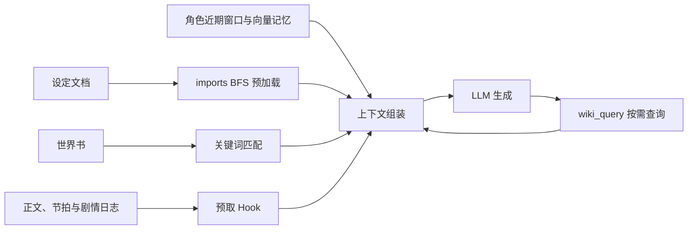

# 知识注入：按确定性分通道召回

新增知识或排查漏注入时，先确定内容应由依赖、关键词、预取还是模型查询进入上下文，再检查会话与节点范围。世界观知识不统一交给向量检索：全量注入成本高，纯语义召回也可能把其他章节的设定提前带入。

> 最近核对：2026-10-11（静态阅读 `wiki_manager.py`、`world_book.py`、`hooks/wiki_prefetch.py`、`CharacterAgent.py`、`memory.py`、`session_context.py` 与叙述组装入口；未运行模型、检索基准或浏览器）。
> 本页由旧 `rag-retrieval.html` 讲解图整理而来；历史估算与已删除机制在末节单独记录。

## 四条召回通道

按内容的可预测程度选择通道，避免必需知识依赖模型临时想起工具调用。

| 通道 | 何时使用 | 当前行为与成本边界 |
|---|---|---|
| ① 声明式依赖预加载 | 会话必然需要的角色与设定 | frontmatter `imports` 沿 BFS 展开：当前会话 `refresh_preload` 以 `max_depth=1` 展开，加载入口全文（full）与直接依赖关键章节（core）。WikiManager 的通用 BFS 还支持深度 2 的一句话摘要（summary），但不是当前会话预加载默认值。世界书对应关系为 `requires`（参与闭包）与 `related`（只作浏览），起点由 `activation` × `expansion` 描述。 |
| ② 关键词触发世界书 | 作者能明确指定何时需要的内容 | 兼容 SillyTavern v1/v2、角色卡内嵌与 JSONL；按主/副关键词及匹配规则触发。召回由作者规则控制，但错误关键词或作用域仍可能造成漏注入或剧透。 |
| ③ 预取 Hook | 剧情即将使用的已知实体 | 不调用 LLM；匹配上一轮正文、当前与下一节拍的 `content/reveals`、最近三条剧情日志中的实体名，跳过已加载内容。按类别优先级最多预取 5 个文档，使用 core 深度。源码称其为毫秒级路径，本次未复测延迟。 |
| ④ `wiki_query` 按需查询 | 未预加载的长尾专名 | 轻量“名称 + 摘要”目录供模型选择；查询打分，多候选返回列表让模型收敛，避免直接灌入模糊全文。工具循环最多 3 轮，结果在会话上下文缓存。 |

`wiki_query` 是有工具支持时的能力，不是所有叙述路径都必然调用；`CharacterAgent` 仅在 WikiManager 可用且不是自定义世界书路径时配置该工具。

依赖闭包与编辑边界见[世界书按需加载](../worldbook/worldbook-on-demand.md)。上述通道不是模型准确理解世界观的保证；排查时要区分未进入候选、未触发、预算裁剪和模型未采用。

## 分层注入与生成

预加载、世界书匹配、预取结果与可用记忆共同组成生成上下文；模型仍可在工具路径查询长尾知识。

- **稳定层**放常驻 `position-0` 条目；保持前缀稳定有利于缓存。
- **动态层**放触发型条目，不能因它本轮命中就移入稳定层。
- 文档依赖按全文 → 关键章节 → 摘要控制长度。前缀结构只能提供缓存条件，不能保证服务商实际命中缓存或固定折扣。

### 节点级候选范围

开启节点作用域时，候选集为 `会话范围 ∩ 当前节点作用域`，不直接扫描整本会话白名单。绑定声明来自永不注入的 `lore_bindings` 系统条目；节点的冻结作用域随快照回档，运行时使用冻结结果。无绑定条目、自由模式或没有节点作用域数据的会话不启用这层窄化。

该层处理哪些条目可进入候选，关键词和预算仍决定最终注入。字段与例外见[节点级世界书加载](../worldbook/node-scoped-worldbook-loading.md)。

## 记忆与剧情摘要的边界

角色向量记忆与上述知识通道并列：默认近期窗口保留 10 轮，远期对话存入 ChromaDB 并按语义召回。构造时先探测远端 embedding，不可用时尝试本地 ONNX，均不可用则退回窗口。嵌入计算、向量添加与 `collection.query` 的异常有降级处理；Chroma 初始化和部分存储读取在这些处理之外，不能保证所有记忆故障都不影响角色对话。只有成功写入的远期记录能据此持久化，滑动窗口本身不等于持久化保证。

剧情节点 `summary` 与会话 `plot_log.md` 仍保留。独立的“每 N 轮压缩成 ≤300 字回忆”生成、注入、间隔设置及 SSE 事件已经退休；不能据 `memory.py` 推断仍有会话级独立回忆摘要。两阶段中的本轮节点摘要见[两阶段叙述](two-phase-narration.md)。

## 已移除机制与历史效果基准

2026-09 世界书工作台重构删除了依赖“AI 自动构建”：原链路为元数据索引 → 分段 → 引用候选对 → 分析卡 → 判定 → 程序校验。依赖关系本身保留，改由人工维护；旧“分类与载入”“节点视图”页签撤销，依赖配置编辑 UI 当前未挂载。历史方法与测量见[构建性能记录](../../archive/worldbook-builder-performance.md)、[选择性阅读记录](../../archive/worldbook-selective-reading.md)；删除范围见[工作台重构提案](../../proposals/worldbook-workbench-redesign.md)。

原讲解图估算同一知识集合全量注入约 39.8k tokens，分层后约 10.2k tokens（−74.4%）。仓库没有可复现该对照的基准脚本，不能作为当前承诺；原图未提供更精确测量日期。`benchmark_worldbook_builder.py` 与 `benchmark_worldbook_selective_reading.py` 也随自动构建删除，历史实测口径留在上述归档中。

实现入口：[WikiManager](../../../src/wiki_manager.py)、[世界书匹配](../../../src/world_book.py)、[预取 Hook](../../../src/hooks/wiki_prefetch.py)、[角色工具循环](../../../src/CharacterAgent.py)、[向量记忆](../../../src/memory.py)。
