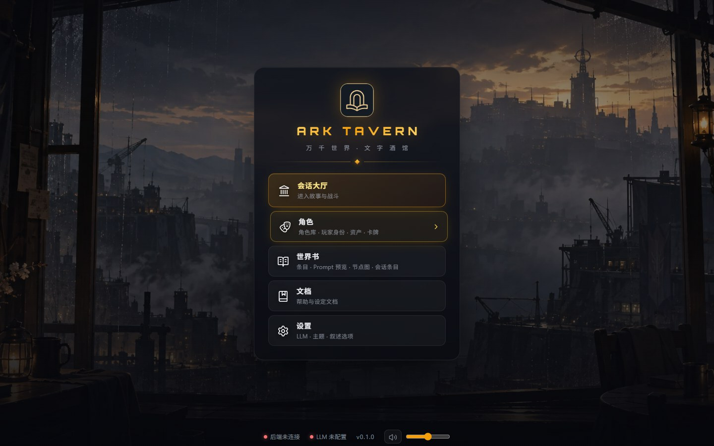
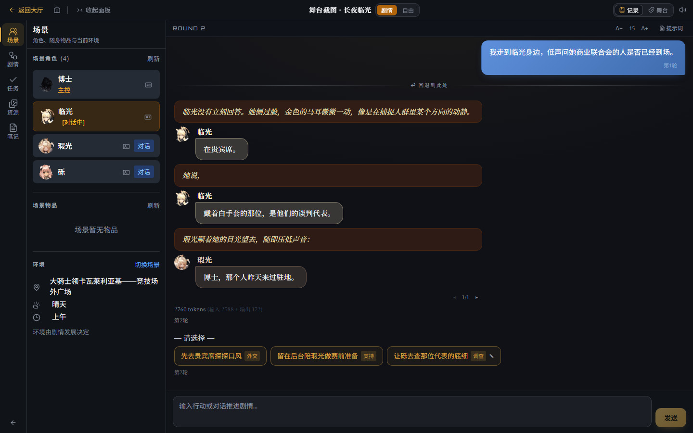
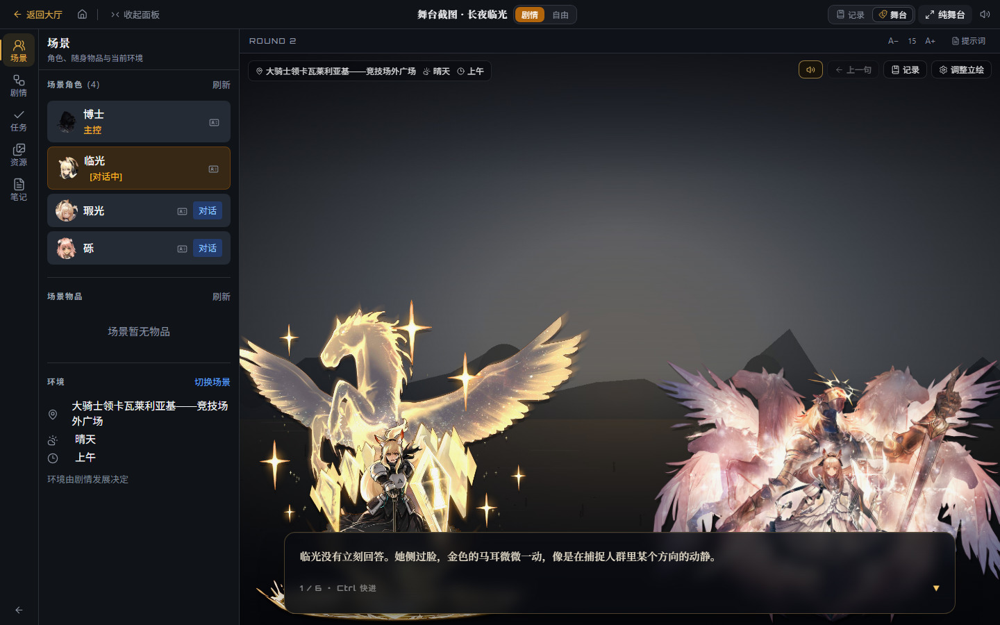
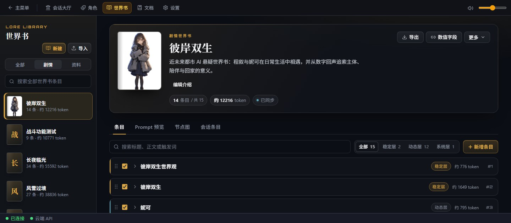
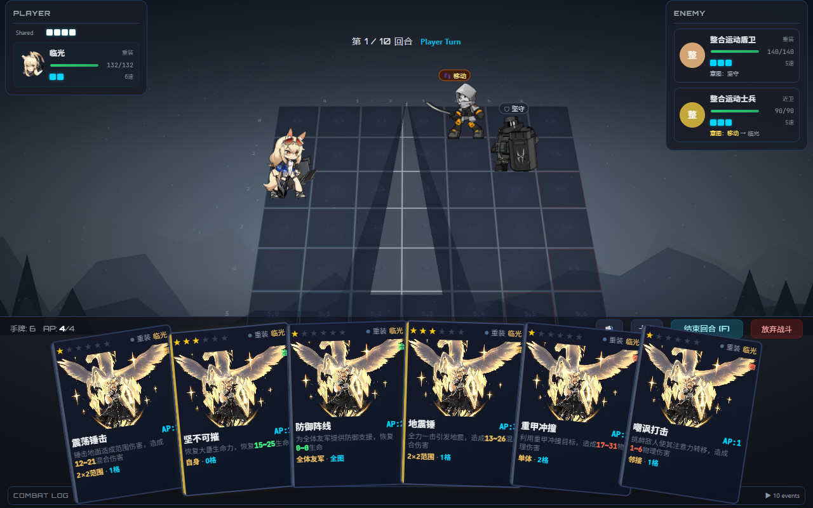
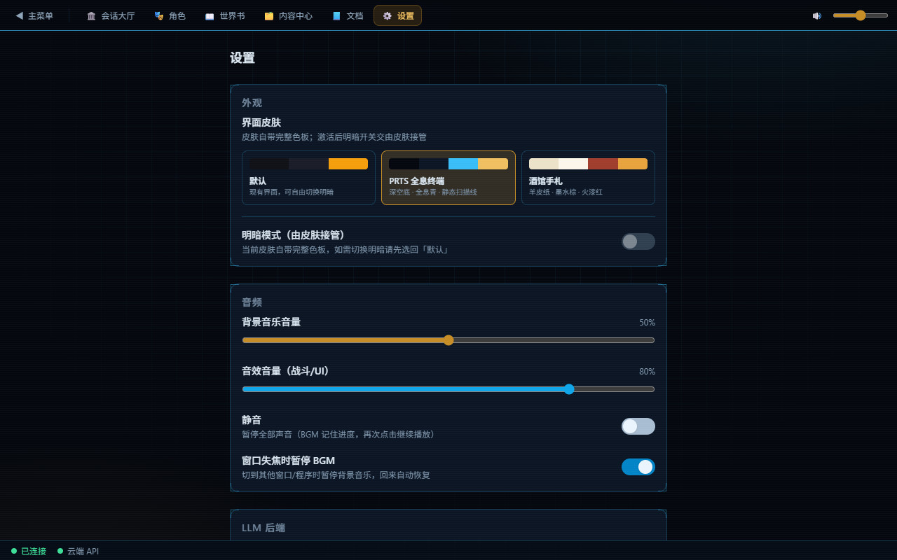

# Ark Tavern 使用教程

本教程带你完成首次启动、模型配置和一轮剧情交互，再介绍世界书、战斗与存档。你可以使用自己的角色和世界观，《明日方舟》只是可选内容。第一次使用不必准备完整故事，可以从一本空白剧情世界书和一名自建主控开始。

本页也是应用内“文档”入口的内容，可用左侧目录跳到需要的章节。截图包含早期界面和示例存档，菜单与按钮可能和当前版本不同；操作步骤以本文和当前界面为准。截图里的角色、世界书与立绘不会随首次启动自动安装。

## 一、准备与启动

当前从源码运行，需要先取得项目文件、安装依赖，再启动前后端。下面的终端命令都从仓库根目录开始执行。

### 1.1 开始前需要什么

| 项目 | 准备内容 |
|---|---|
| 电脑 | Windows、macOS 或 Linux |
| Python | 已安装并能在终端调用；开发记录使用 Python 3.12 |
| Node.js | 已安装，包含 npm |
| 模型服务 | 云端 API 的地址、密钥和模型名称，或已启动且装有模型的本地 Ollama |
| 项目文件 | 本仓库源码，包含 `requirements.txt` 和 `frontend/` |

先在终端检查 `python --version` 和 `node --version`。macOS、Linux 如果使用 `python3` 命令，后续应使用同一 Python 环境安装依赖和启动后端。未配置模型时仍能浏览界面，生成故事和角色回复需要可用模型。

### 1.2 Windows：安装依赖并启动

在 PowerShell 中进入仓库根目录，首次运行执行：

```powershell
python -m pip install -r requirements.txt
cd frontend
npm install
cd ..
.\scripts\restart-win.bat
```

之后从仓库根目录运行 `.\scripts\restart-win.bat` 即可。脚本先启动 Flask 后端，等待就绪，再启动前端和 Electron 窗口。

重启脚本会清理项目进程以及占用默认 `5000`、`5173` 端口的进程，运行前确认这些端口没有被其他项目使用。通过该脚本启动时，关闭游戏窗口或在启动终端按 `Ctrl+C` 会触发清理；若启动失败，先查看终端中的错误。

### 1.3 macOS：准备虚拟环境并启动

macOS 启动脚本使用仓库根目录的 `.venv`。首次运行执行：

```bash
python3 -m venv .venv
.venv/bin/python3 -m pip install -r requirements.txt
cd frontend
npm install
cd ..
bash scripts/restart-mac.sh
```

之后运行 `bash scripts/restart-mac.sh`。脚本使用同样的默认端口，并在退出时清理启动的进程；运行前确认端口没有被其他项目使用。

### 1.4 手动启动与浏览器入口

Linux 或需要分别管理服务时，可以手动启动。先使用对应 Python 环境安装 `requirements.txt` 中的依赖，并在 `frontend/` 执行 `npm install`。

终端 1 在仓库根目录启动后端：

```bash
python src/app.py
```

macOS、Linux 使用虚拟环境时，把这里的 `python` 换为 `.venv/bin/python3`。

终端 2 在仓库根目录启动前端：

```bash
cd frontend
npm run dev
```

`npm run dev` 打开 Electron 桌面窗口。若要用浏览器，把最后一行换为 `npm run dev:web`，再手动打开 `http://localhost:5173`。手动启动的服务需保留终端运行，结束时分别按 `Ctrl+C`；关闭浏览器页签不会停止服务。

窗口打开后点击“点击进入”，检查底部后端状态。**后端显示“已连接”**后再配置模型；这不代表模型也已可用。



*图像描述：工业城市背景前的主菜单列出会话大厅、角色、世界书、文档和设置，底部显示连接状态与音乐控制；当前版本还包含“战斗模式”入口。*

## 二、配置并保存模型

从主菜单进入“设置”，找到“LLM 配置”。先配置一种可用服务即可，不必同时准备云端和本地模型。

### 2.1 云端 API

使用服务商提供的参数，不要把网页聊天地址当作 API 地址。

1. 在“云端 API”区域选择接口类型：自动（OpenAI 兼容）、OpenAI 或 DeepSeek。
2. 填写 API Key、API 地址和模型名称。
3. 点击该区域的“测试连接”，查看成功结果或失败原因。
4. 测试成功后点击页面底部的**“保存配置”**，等待“配置已保存”。

“测试连接”只测试当前表单，不会自动保存。若密钥、地址或模型不匹配，先修正对应字段再测试。

### 2.2 本地 Ollama

先按 [Ollama](https://ollama.com) 的说明安装服务并准备模型，再回到设置页。

1. 在独立的“Ollama 本地”区域填写地址；服务运行在本机时通常使用 `http://localhost:11434`。
2. 填入已安装的模型名称。
3. 点击该区域的“测试连接”。
4. 成功后点击页面底部“保存配置”。

Ollama 不在云端接口类型下拉中。连接失败时，先确认 Ollama 服务已启动、地址可达且模型已安装。

### 2.3 主备后端

保存后可在“LLM 后端”区域查看已发现的服务并切换端点。需要备用时再配置第二种服务；主后端失败且有可用备用时，系统会尝试降级。备用也不可用或请求仍失败时，界面会显示错误，需要按错误原因处理后重试。

## 三、准备主控并创建会话

每个会话是一份独立存档，保存阵容、世界书绑定和交互进度。主控是你扮演的角色，队友是参与故事的其他角色；模型不会替你发言。

### 3.1 首次使用：准备一本书与玩家身份

没有导入内容时，先建立保存身份的剧情世界书，再创建一名自己的主控，无需下载角色卡或编写完整设定。

1. 进入“世界书”，点击“新建”，填写名称，例如“我的故事”，用途选择“剧情世界书”，再点击“创建”。简介、封面和条目可以暂时不填。
2. 进入“角色”，切到“玩家身份”页签，点击“新建身份”。
3. 填写身份名称，例如“旅者”，保存位置选择刚创建的“我的故事”；简介和身份背景按需要填写。
4. 点击“保存身份”，看到“已创建玩家身份”。当前保存身份需要指定所属世界书，不要选择“个人资料”。

也可以先在角色库导入角色卡，再从已有角色中选择主控。

### 3.2 创建第一份会话

进入“会话大厅”，点击“新建”，按向导完成：

1. **选择交互与战斗模式**。首次选择“剧情”与“纯剧情叙述”；自由聊天需另外准备至少一名队友。战斗模式创建后不能更改。
2. **选择剧情，可跳过**。未导入剧情时直接继续。
3. **绑定剧情世界书，可多选**。本次选择刚创建的“我的故事”，使该书中的身份出现在角色候选中。资料库不参与会话；选中剧情时可能自动选中其所属世界书。
4. **选择主控，队友可选**。从准备好的角色中选一名主控；没有可选角色时，先返回“角色”创建身份或导入角色卡。
5. **命名并创建**。确认阵容和绑定书；收尾显示的 token 数是估算量，不是逐条载入明细。

这本空白书不需要先填入世界观条目，仍可开始剧情。以后绑定有内容的书，也不等于把所有条目塞进每轮提示词，实际内容还受载入与触发规则影响；未绑定书时不载入世界书内容。

创建和保存会话本身不调用模型；**创建成功进入剧情对话页后，会自动请求模型生成开场**。请先完成模型配置。自由模式等待你发出第一条消息。

## 四、阅读并推进第一轮交互

进入对话页后，等待开场或发送消息。先完成一次“阅读 → 输入或选择 → 得到下一段回复”，再使用回退、变体和其他工具。

### 4.1 剧情与自由交互

- **剧情交互**：阅读叙述结束后的行动选项，或在输入框写下行动并发送。正在生成时等待完成，再提交下一次行动。
- **自由交互**：先在会话阵容中加入至少一名队友，再在输入框发送你的话，让场景角色回应；只有主控时没有可回复的场景角色。角色行的“对话”按钮可切换当前对话目标。
- **调整阵容**：返回会话大厅管理主控和队友，不能按旧教程在场景面板中“＋添加角色”。
- **查看场景**：左侧“场景”显示角色、物品和环境。物品与环境的显示不等于提供手动编辑入口。

可以先输入一句简单行动，例如“我环顾四周，看看附近有什么”。收到正常叙述或角色回复后，首次交互就完成了。若返回模型错误，回到设置核对连接与已保存配置。

### 4.2 记录、舞台与节点图

对话页右上角可以切换展示方式，消息和会话进度仍属于同一份存档。

| 展示方式 | 适合做什么 |
|---|---|
| 记录 | 阅读完整消息、操作回退和叙述版本 |
| 舞台 | 逐句阅读当前叙述与台词，配合背景和角色立绘 |
| 节点图 | 剧情会话中查看轨迹、位置和只读详情，并对有快照的历史节点回档 |

舞台中点击对话框，或在未聚焦输入框时按空格、回车推进。文字尚未打完时，第一次操作可能先补全文字；走到当前段末尾再选择行动。需要旧消息时打开“记录”或切回记录布局。舞台还提供“纯舞台”，用于收起其他界面元素。

画面可能来自作者配置的背景或 CG、当前地点及会话资源；图片尚未就绪时，正文仍可阅读。



*图像描述：示例存档左侧展示角色与环境，右侧依次显示玩家输入、角色对话、行动选项和输入框；其中的角色需要自行导入。*



*图像描述：示例舞台中央展示角色立绘，底部对话框呈现当前叙述，左侧保留场景面板。*

### 4.3 回退、修改与叙述变体

这些操作用于重选行动或尝试另一种叙述。回退会恢复对应剧情进度与快照中的游戏状态，操作前注意目标位置。

- **轮次回退**：在记录中点击“回退到此处”。
- **节点回档**：在会话节点图双击节点，或聚焦节点后按 Enter、空格打开详情；有快照且非当前的会话节点提供“回档到此节点”。确认后恢复该节点，之后的进度会被清除；作者节点内容在这里不可编辑。
- **修改玩家消息**：悬停自己的消息，点击编辑，再“保存并继续”。
- **叙述变体**：使用叙述下方的版本箭头切换；在最后一个版本继续点击向右箭头，可输入提示词重新生成。

## 五、添加世界书与角色内容

世界书保存世界观、人物与规则等设定。初次体验使用空白剧情书也能开始；想让故事遵循具体背景时，再添加条目或导入内容。

### 5.1 剧情世界书与资料库

两种用途决定书籍是否参与会话。

| 用途 | 使用方式 |
|---|---|
| 剧情世界书 | 明确绑定到会话后，条目按载入规则与触发条件参与叙事 |
| 资料库 | 用于浏览、检索和摘录，不参与会话注入 |

没有全局默认世界书。要让一本剧情书参与当前会话，应在向导或会话大厅明确绑定。

在资料库找到条目后，可以点击“加入剧情世界书”，选择目标书，并按需要修改标题、正文与触发词。摘录不修改来源书，也不需要调用模型。

### 5.2 创建、导入与分享

在“世界书”页点击“新建”创建一本书，或点击“导入”使用已有文件。可导入酒馆世界书 JSON、含世界书的角色卡 PNG/JSON、受支持的 JSONL 聊天备份，也可粘贴 JSON。含角色的角色卡会连带导入角色。

酒馆文件通常不包含独立图片、音乐、剧情与战斗资源。分享完整世界书时，需要复制 `data/worldbooks/books/<book_id>/` 整个文件夹；接收方将其放到同样的 `books/` 目录后刷新书架。文件夹名应与 `book.json` 的 ID 一致，同 ID 的已有书不会因刷新而被覆盖。

角色库的“导入”也可直接导入角色卡。角色、资产和卡牌按来源世界书组织；先准备角色和设定，再回大厅调整会话绑定与阵容。

### 5.3 工作台能做什么

剧情世界书有四个页签；资料库保留“条目”和“会话条目”。

| 页签 | 用途 |
|---|---|
| 条目 | 浏览、搜索和编辑条目，导入导出；资料库可检索并摘录到剧情书 |
| Prompt 预览 | 检查本书全部启用条目的插入内容、位置与顺序 |
| 节点图 | 编辑书内剧情节拍和战斗节点 |
| 会话条目 | 为选定会话设置“跟随默认 / 启用 / 停用”覆盖 |

**Prompt 预览不等于当前对话或下一次模型请求。** 真实注入还受会话范围、关键词、概率、预算和节点规则影响，不能仅凭这里显示了条目就判断模型已经收到它。

会话条目的覆盖不会改写全局书或其他会话。旧“分类与载入”页签不在当前工作台；需要微调当前会话的依赖关系，可使用会话大厅中的依赖微调入口。



*图像描述：左侧书架选中一本示例剧情世界书，右侧显示条目、Prompt 预览、节点图和会话条目四个页签。*

## 六、尝试战斗

战斗模式在创建会话时选定。第一次可先使用纯剧情叙述；需要实际玩法时，再选择回合战术、横版动作或已安装的脚本模式。

### 6.1 演练与会话战斗

- **独立演练**：会话大厅的“战斗演练”提供回合战术和横版动作，不改变会话剧情进度。横版演练使用示例关卡并在本机保存续玩。
- **网格会话战斗**：选择回合战术的剧情会话可由故事触发遭遇，也可在相应入口输入已绑定书的战斗节点 ID 手动开战。
- **横版与脚本玩法**：使用对应模式的遭遇入口，不能把网格节点 ID 直接当作所有玩法的输入。
- **脚本模式**：在主菜单“战斗模式”管理安装包。使用时按向导完成兼容性检查与信任确认；当前脚本结果需要玩家确认，不发数值奖励。

会话内战斗与演练的保存和结果用途不同，不能把演练结果当成当前剧情进度。

### 6.2 基本操作

以下是内置玩法的快捷键；第三方模式按其自身界面提示操作。

| 玩法 | 操作 |
|---|---|
| 回合战术 | 点击或用 `1–9`、`0` 选牌，拖向合法目标格打出；`F` 结束回合，`Esc` 取消当前选择 |
| 横版动作 | `A/D` 移动，空格跳跃，Shift 闪避，`J` 攻击，`K` 技能，`L` 援护，`Esc` 暂停 |



*图像描述：示例回合战术界面中央是网格战场，左右展示双方状态，底部排列手牌与结束回合操作。*

## 七、场景面板、数值与存档

左侧面板提供当前会话的信息和资源操作。可从顶栏收起面板，或点击左侧图标重新展开。

- **场景**：查看角色、随身物品和环境；悬停角色查看详情，也可固定详情卡。
- **剧情**：剧情会话中查看当前位置、默认展开的作者节拍骨架和角色状态；详情与节点回档在会话节点图操作。
- **任务**：查看剧情会话的任务状态。
- **资源**：更换本会话的角色形象或战斗背景。上传角色图片后，先进入候选列表，再点击缩略图应用。
- **扩展面板**：例如随附的“笔记”，用于保存本会话的自定义内容。

需要叙事数值时，先在世界书“数值字段”中定义字段，再在角色详情的“数值”页设置角色初值。当前会话中，通过场景角色详情的“会话叙事数值”修改并点击“保存数值”；这些改动只影响本会话，并按剧情快照参与回档。

存档导入和导出在**会话大厅**完成，“资源”面板不提供存档导入导出。导出触发存档 ZIP 下载，保存位置由浏览器或桌面下载设置决定；导入时按界面提示选择存档 ZIP。

## 八、导航与其他设置

掌握基本交互后，可按需要进入管理页面。管理页顶栏提供导航；对话与战斗页面保留各自的返回入口。

| 主菜单入口 | 用途 |
|---|---|
| 会话大厅 | 新建和管理存档、绑定书、配置阵容、进入故事与演练 |
| 角色 | 角色库、玩家身份、资产和卡牌 |
| 世界书 | 书籍与条目管理、预览和节点编辑 |
| 战斗模式 | 当前脚本模式的安装与管理 |
| 文档 | 本教程 |
| 设置 | 模型、窗口、外观、音频和叙述选项 |

设置中的其他常用项：

- **外观**：默认、PRTS 全息终端和酒馆手札；默认皮肤可切深浅，专用皮肤使用自身色板。
- **音频**：背景音乐、音效音量、静音与窗口失焦暂停 BGM。
- **桌面窗口**：在 Electron 中选择窗口尺寸和显示模式。
- **叙述**：思考档位、选项生成与数量、目标字数、发送前编辑及头像气泡。



*图像描述：早期设置页展示三套皮肤、明暗选项、音量与静音；顶栏中的旧“内容中心”不是当前入口。*

## 九、遇到问题时

先区分启动、模型和内容问题，再检查对应位置。

| 现象 | 先检查什么 |
|---|---|
| 终端找不到 Python 或 npm | 运行时是否已安装并加入 PATH，当前终端能否执行版本命令 |
| 窗口未打开或后端“未连接” | 启动终端错误、Python 依赖、前后端服务与默认端口 |
| 测试连接成功，故事仍无法生成 | 是否点击“保存配置”，当前后端与模型是否仍可用 |
| 主控列表为空 | 是否已经保存玩家身份或导入角色卡；绑定书也会影响角色候选范围 |
| 世界书没有影响故事 | 是否为剧情世界书并绑定会话，条目是否启用，以及载入和触发条件 |
| 截图中的按钮找不到 | 截图可能来自早期界面，按本文的当前入口查找 |

更完整的项目介绍见仓库根目录 `README.md`。开发与排查时，从 `docs/architecture.md` 查模块入口，从 `docs/notes.md` 查环境差异、约定与已知问题。场景面板开发说明位于 `frontend/src/plugins/README.md`，不属于首次游玩的必读内容。
